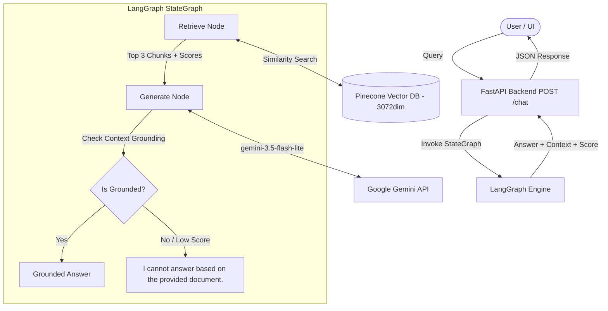

# Agentic AI Knowledge Assistant — RAG-based Chatbot

A production-quality Retrieval-Augmented Generation (RAG) chatbot that answers user questions strictly based on an Agentic AI eBook PDF using **LangChain**, **LangGraph**, **Google Gemini API**, **Pinecone Vector Database**, **FastAPI**, and **Streamlit**.

---

## 📢 Model Provider Migration Notice

> **Note**: This project was updated to use **Google Gemini API** (`gemini-3.5-flash-lite` for reasoning & generation, `models/gemini-embedding-001` with 3072 output dimensions for embeddings) in place of OpenAI due to API credit limits. All 3072-dimensional Pinecone vector store configurations, LangGraph workflows, FastAPI endpoints, and Streamlit interfaces remain fully preserved.

---

## 🌟 Features & Highlights

- **Strict Document Grounding**: Responds ONLY using retrieved context from the eBook. Refuses out-of-scope questions with `"I cannot answer based on the provided document."`
- **LangGraph StateGraph Workflow**: Modular nodes for document retrieval, cosine relevance scoring, and grounded LLM generation.
- **Google Gemini 3.5 Flash Lite**: Fast reasoning LLM integrated via `langchain-google-genai`.
- **FastAPI REST Backend**: Asynchronous endpoint (`POST /chat`) with schema validation.
- **Streamlit Web UI**: Interactive chat interface with full history, expandable context chunks, and confidence score displays.
- **Pinecone Vector Search**: 3072-dimensional vector storage with cosine similarity metric.

---

## 🏗️ Architecture & RAG Pipeline



---

## 🛠️ Tech Stack

- **Language**: Python 3.10+
- **Orchestration**: LangChain & LangGraph
- **LLM**: Google Gemini (`gemini-3.5-flash-lite`)
- **Embeddings**: Google Generative AI (`models/gemini-embedding-001`, `dimension=3072`)
- **Vector Database**: Pinecone
- **PDF Processing**: `pypdf` (PyPDFLoader) & `RecursiveCharacterTextSplitter`
- **Backend API**: FastAPI & Uvicorn
- **Frontend App**: Streamlit
- **Environment**: `python-dotenv`

---

## 🚀 Setup & Installation Instructions

### Step 1: Clone or Navigate to Project Directory
```powershell
cd "p:/Rag Chatbot"
```

### Step 2: Install Required Dependencies
```powershell
pip install -r requirements.txt
```

### Step 3: Configure Environment Variables
Copy `.env.example` to `.env` and set your API keys:
```powershell
cp .env.example .env
```

Open `.env` and set your credentials:
```env
GEMINI_API_KEY=your_actual_gemini_api_key
PINECONE_API_KEY=your_actual_pinecone_api_key
PINECONE_INDEX_NAME=agentic-ai-index
PDF_PATH=data/agentic_ai_ebook.pdf
```

---

## 📄 PDF Ingestion

Place your eBook PDF in `data/agentic_ai_ebook.pdf` and run:

```powershell
python -m src.ingestion
```

---

## 🖥️ Running the Application

### Option 1: Run Backend API (FastAPI)
```powershell
python app.py
```
*API docs available at `http://127.0.0.1:8000/docs`.*

### Option 2: Run Frontend UI (Streamlit)
```powershell
streamlit run streamlit_app.py
```
*App opens at `http://localhost:8501`.*

---

## 🧪 Testing Suite

Run the evaluation test queries script:

```powershell
python tests_sample_queries.py
```
# agentic-ai-rag-chatbot
